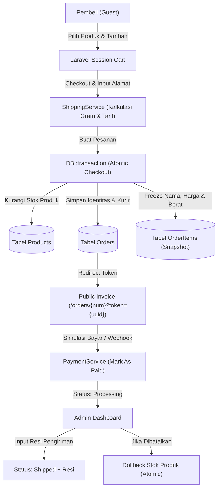

# 🐾 PawPalace Petshop — Modern E-Commerce (Guest-First Architecture)

[](https://laravel.com)
[](https://php.net)
[](https://tailwindcss.com)
[](https://alpinejs.dev)
[](https://mysql.com)
[-success?style=for-the-badge&logo=githubactions&logoColor=white)](#-pengujian--testing)

Aplikasi web E-Commerce Petshop modern, cepat, dan siap pakai yang dibangun di atas **Laravel 13** dengan arsitektur **Guest-First (Zero-Login)**. Dirancang khusus untuk toko kebutuhan hewan peliharaan (makanan, vitamin, perawatan, aksesoris) dengan integrasi perhitungan logistik presisi (berat gram) dan simulasi alur pembayaran end-to-end tanpa overhead autentikasi yang rumit bagi pembeli.

---

## 🌟 Fitur Utama & Filosofi Desain

### 1. 🛒 Sisi Pembeli (Storefront & Guest Experience)
- **Zero-Login Checkout:** Pembeli dapat langsung memilih produk, mengisi data pengiriman, dan checkout tanpa perlu mendaftar atau login akun.
- **Session Shopping Cart:** Keranjang belanja berbasis session Laravel dengan kontrol kuantitas real-time, validasi stok dinamis, serta kalkulasi otomatis subtotal harga dan akumulasi bobot pengiriman (gram/kg).
- **Katalog & Pencarian Cepat:** Filter kategori produk (*Makanan Kucing, Makanan Anjing, Pasir & Kebersihan, Vitamin & Perawatan, Aksesoris & Mainan*), pencarian nama produk, indikator stok menipis, dan badge stok habis.
- **Simulasi Ongkos Kirim Realistis:** Tarif logistik dihitung otomatis per kelipatan kilogram dari total berat item pesanan dengan pilihan kurir:
  - JNE Regular (Rp 18.000 / kg)
  - J&T Express (Rp 20.000 / kg)
  - Kurir Instan Lokal (Rp 25.000 / kg)
- **Invoice Publik Aman (Tracking Token):** Halaman invoice transaksi dapat diakses langsung oleh pembeli melalui URL bertoken UUID unik (`/orders/{order_number}?token={tracking_token}`).
- **Simulasi Pembayaran (Mock Payment):** Pembeli dapat menguji pembayaran langsung via tombol simulasi, yang seketika mengubah status menjadi `paid` dan memajukan alur pesanan ke `processing`.
- **Lacak Pesanan Mandiri (`/track-order`):** Pembeli dapat melacak status pengiriman dan nomor resi kapan saja hanya dengan memasukkan Nomor Pesanan dan Nomor WhatsApp.

---

### 2. 🔐 Sisi Pengelola (Admin Dashboard & Logistik)
- **Portal Terproteksi Auth:** Autentikasi bawaan Laravel yang aman dan ringan tanpa package RBAC berat.
- **Ringkasan Metrik Bisnis:** Kartu statistik real-time:
  - Total Pendapatan Bersih (dari pesanan status `paid`)
  - Pesanan Baru Perlu Diproses (`processing`)
  - Paket Dalam Pengiriman (`shipped`)
  - Peringatan Stok Menipis (`stock <= 5`)
- **Manajemen Katalog & Kategori (CRUD):** 
  - Validasi ketat produk: Harga (`min: 1`), Berat Gram (`min: 1`), dan Stok (`min: 0`).
  - Pencegahan penghapusan kategori jika masih memiliki relasi produk aktif.
- **Manajemen Pesanan & Logistik:**
  - Filter pesanan berdasarkan status pesanan (`pending`, `processing`, `shipped`, `completed`, `cancelled`) dan status bayar (`unpaid`, `paid`).
  - Verifikasi pembayaran manual (ubah `unpaid` -> `paid`).
  - **Input Nomor Resi:** Pengisian resi otomatis memperbarui status pesanan menjadi `shipped`.
  - **Pembatalan Pesanan Aman:** Membatalkan pesanan (`cancelled`) otomatis mengembalikan stok seluruh item ke inventaris menggunakan `DB::transaction`.

---

## 🏗️ Pola Arsitektur & Integritas Data



1. **Snapshot Item Pesanan (`order_items`):**
   Setiap transaksi membekukan nama produk, harga satuan, dan berat gram pada saat pembelian (`product_name_snapshot`, `price_snapshot`, `weight_grams_snapshot`). Perubahan harga produk di masa depan tidak akan merusak riwayat transaksi terdahulu.
2. **Atomic Inventory Control (`DB::transaction`):**
   Mencegah *race condition* saat dua pelanggan membeli produk terakhir secara bersamaan. Pengurangan stok hanya dieksekusi jika kuantitas mencukupi.
3. **Future-Proof Service Classes:**
   - `App\Services\ShippingService`: Menangani komputasi tarif kurir. Siap diganti implementasi API resmi (RajaOngkir / Biteship / Shipper) tanpa merombak controller dan view.
   - `App\Services\PaymentService`: Menangani inisialisasi transaksi pembayaran. Siap disambungkan ke Midtrans Snap / Xendit Invoice.

---

## 📱 Desain Responsif Lintas Perangkat

Aplikasi telah diaudit menggunakan **3-Layer SOP (Route Crawl, Multi-Device Heuristic, Self-Healing)**:
- **Mobile (320px – 425px):** Input formulir `w-full`, touch targets min. 40px, Alpine.js off-canvas drawer navigation untuk panel admin, dan seluruh elemen tabel dibungkus kontainer scroll horizontal (`overflow-x-auto w-full`).
- **Tablet (768px – 1024px):** Transisi mulus multi-kolom grid (`sm:grid-cols-2 lg:grid-cols-3`).
- **Desktop (1280px+):** Kontainer dibatasi `max-w-7xl mx-auto px-4 sm:px-6 lg:px-8` agar layout nyaman dipandang di monitor lebar.

---

## 🗄️ Skema Database

```text
users                 # Khusus administrator toko
categories            # Klasifikasi produk (slug, is_active)
products              # SKU, harga (IDR), stok, weight_grams, image_url, is_active
orders                # order_number, tracking_token (UUID), biodata penerima, 
                      # kurir, ongkir, resi, subtotal, grand_total, payment_status, order_status
order_items           # Snapshot relasi produk pesanan (nama, harga, berat, qty, subtotal)
```

---

## 🚀 Panduan Instalasi Lokal

### Prasyarat
- PHP >= 8.2 (Disarankan PHP 8.4 atau 8.5)
- Composer
- Node.js & NPM
- MySQL / MariaDB

### Langkah Instalasi
1. **Clone Repositori:**
   ```bash
   git clone https://github.com/Adanix/petshop-laravel_13.git
   cd petshop-laravel_13
   ```

2. **Install Dependensi PHP & JavaScript:**
   ```bash
   composer install
   npm install
   ```

3. **Konfigurasi Environment:**
   ```bash
   cp .env.example .env
   php artisan key:generate
   ```
   *Sesuaikan pengaturan koneksi database `DB_*` di file `.env`.*

4. **Migrasi & Seeding Data Awal:**
   ```bash
   php artisan migrate:fresh --seed
   ```

5. **Kompilasi Aset Frontend:**
   ```bash
   npm run build
   # atau untuk mode live development:
   npm run dev
   ```

6. **Jalankan Web Server Lokal:**
   ```bash
   php artisan serve
   ```
   Akses aplikasi di: `http://localhost:8000`

---

## 🔑 Akun Bawaan (Default Seeder)

Data awal telah diisi dengan produk realistis, kategori lengkap, serta pesanan contoh untuk pengujian:

| Role | Email | Password | Halaman Login |
| :--- | :--- | :--- | :--- |
| **Store Administrator** | `admin@petshop.test` | `password123` | `/admin/login` |

### Contoh Pesanan Dummy untuk Uji Coba Cek Resi (`/track-order`):
- **No. Pesanan:** `PET-20261014-B001` | **WhatsApp:** `081234567890` *(Status: Pending / Unpaid)*
- **No. Pesanan:** `PET-20261014-S002` | **WhatsApp:** `081298765432` *(Status: Shipped / Resi: JNE9988112233ID)*

---

## 🧪 Pengujian & Testing

Seluruh alur bisnis telah dicakup oleh automated feature & unit tests:

```bash
php artisan test
```

```text
PASS  Tests\Unit\ExampleTest
PASS  Tests\Feature\ExampleTest
PASS  Tests\Feature\PetshopTest
  ✓ catalog displays products and categories
  ✓ filter by category
  ✓ product detail page
  ✓ cart operations
  ✓ guest checkout flow and stock reduction
  ✓ mock payment marks order as paid and processing
  ✓ track order lookup
  ✓ admin login and dashboard
  ✓ admin order tracking and cancellation stock rollback

Tests:    11 passed (54 assertions)
```

---

## 📄 Lisensi

Proyek ini dirilis di bawah lisensi terbuka [MIT License](LICENSE).
Bebas dimodifikasi dan dikembangkan lebih lanjut untuk kebutuhan komersial maupun edukasi.
